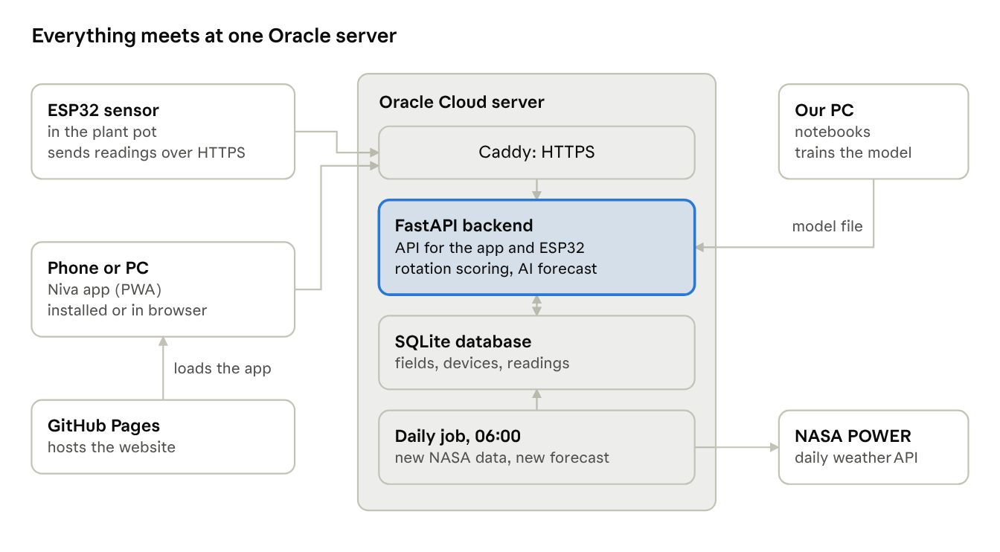

# Niva — Design Plan

Nov 14, 2026 · Team Niva

What we build, part by part: four pieces (ESP32 sensor, Oracle backend, PWA website, data and AI pipeline) and the tools for each. [PLAN.md](PLAN.md) says why; this doc says how.

## Architecture

Niva has four parts, and all live data goes through one Oracle server: the ESP32 writes to it, the app reads from it, and our PC only prepares the AI model.



The website itself comes from GitHub Pages; every number in it comes from the Oracle server over HTTPS.

## Tech stack

Every tool is free, well documented and quick to learn. Where a choice is open, the default is listed first; switch only if a team member knows the other one well.

| Layer | Tool | Used for |
| --- | --- | --- |
| **Sensor firmware** | Arduino framework on ESP32 (Arduino IDE or PlatformIO in VS Code) | Reading sensors, WiFi, sending data |
| | Libraries: OneWire, DallasTemperature, Adafruit BME280 / BMP280, DHT sensor library, ArduinoJson, WiFiManager, HTTPClient, WiFiClientSecure | One library per job, all standard |
| **Backend** | Python 3.12 + FastAPI + uvicorn | The API the app and ESP32 call |
| | SQLModel on SQLite | Database: one file, no setup |
| | APScheduler | The daily job (new NASA data, new forecast) |
| | httpx | Calling the NASA POWER API |
| | pandas, scikit-learn, joblib | Running the AI model |
| **Server** | Oracle Cloud Always Free VM, Ubuntu 22.04 | Runs the backend 24/7 |
| | Caddy | HTTPS certificate, forwards to FastAPI |
| | sslip.io | Free web address for the server (no sign-up; the IP is in the name) |
| | systemd | Restarts the backend after crashes or reboots |
| **Website (PWA)** | Vite + React (JavaScript) | The app |
| | React Router | Moving between screens |
| | vite-plugin-pwa | Install on phone/PC, works offline |
| | Leaflet + OpenStreetMap | Field map |
| | Chart.js (react-chartjs-2) | Climate charts and forecast band |
| | html5-qrcode | Scanning the sensor's QR code |
| | `niva-theme.css` + plain CSS | Niva colours, light and dark mode |
| | Two JSON files, `mk.json` and `en.json` | Macedonian and English text |
| | GitHub Pages + GitHub Actions | Free HTTPS hosting, deploys on every push |
| **Data and AI** | Jupyter notebooks, pandas, scikit-learn, matplotlib | Downloading NASA data, training the model, slide charts |
| | NASA Earthdata account, AppEEARS, Giovanni | Getting SMAP, IMERG, SRTM |
| **Team tools** | GitHub (one public repo), this doc, a group chat | Code, plan, talking |

## Repository structure

One GitHub repo, one folder per part, so the four roles rarely touch the same files.

```
niva/
├── firmware/niva_sensor/     ESP32 (Hardware role); Arduino IDE needs folder name = sketch name
│   ├── niva_sensor.ino       main sketch
│   ├── config.h              pins, server address, calibration numbers
│   ├── root_ca.h             Let's Encrypt root certificates for HTTPS
│   └── secrets.h             device key (not in git; copy secrets.example.h)
├── backend/                  Python server (App role)
│   ├── main.py               FastAPI app and routes
│   ├── models.py             database tables
│   ├── manage.py             admin: add-device, pair, list fields/devices
│   ├── scoring.py            rotation scoring rules
│   ├── forecast.py           loads the AI model, makes forecasts
│   ├── nasa.py               NASA POWER calls
│   ├── jobs.py               daily job
│   └── requirements.txt
├── web/                      the PWA (App role)
│   ├── public/icons/         app icons from the logo
│   ├── src/screens/          one file per screen
│   ├── src/components/       cards, charts, sliders
│   ├── src/i18n/             mk.json, en.json
│   └── src/api.js            all calls to the backend in one place
├── data/                     Data role
│   ├── notebooks/            download, indicators, model training
│   ├── locations/            one folder per demo location
│   ├── crops.json            the 14-crop table
│   ├── rotations.json        the rotation library
│   ├── prices.json           crop prices (ZPIS / MakStat)
│   └── buyers.json           registered buyers (Ministry register)
├── deploy/                   Caddyfile, systemd service file, setup notes
├── brand/                    logo, team photo, niva-theme.css
└── docs/                     plan, slides, screenshots, reference files
```

Rule: never commit passwords or device keys. Keep them in a `.env` file on the server, listed in `.gitignore`.

## ESP32 firmware

The firmware does one loop: read the sensors, send one JSON message over HTTPS, wait, repeat. Everything else is setup and error handling.

### What happens when it starts

1. **No saved WiFi?** Open the "Niva-Setup" network and setup page (WiFiManager). Blue LED blinks slowly
2. **WiFi saved:** connect. LED stays on when connected
3. **Loop:** read sensors → build JSON → `POST https://<server>/readings` → also print the JSON over USB (the Web Serial backup) → wait
4. **Send failed?** Keep up to 50 readings in memory and send them on the next success. LED blinks fast
5. **Hold the BOOT button 5 seconds:** forget the WiFi and go back to step 1

### Settings in `config.h`

| Setting | Demo value | Field value |
| --- | --- | --- |
| Send interval | 5 seconds | 10 minutes |
| Server address | `https://niva-api.92-5-133-111.sslip.io` | same |
| Device ID | `NIVA-` + last 4 characters of the chip's MAC address, printed on the QR sticker | same |
| Device key | A random secret, also stored on the server | one per device |
| Soil calibration | raw value in dry air, raw value in water | measured per sensor |

### The message it sends

Headers `X-Device-Id` and `X-Device-Key`, body:

```json
{"soil_pct": 43, "soil_temp_c": 17.2, "air_temp_c": 21.5, "humidity_pct": 48, "pressure_hpa": 1012, "battery_v": null}
```

A sensor that fails sends `null` for its value instead of a wrong number; the app hides it. The server adds the time, so the ESP32 needs no clock.

## Backend (Oracle server)

The backend is one FastAPI app with five database tables, about a dozen endpoints and one daily job. Crops and rotations are read from JSON files, not stored in the database, so the Data role can edit them without touching code.

### Database tables (SQLite)

| Table | Columns | Notes |
| --- | --- | --- |
| `fields` | id, name, lat, lon, region, current_rotation, priorities, owner_token | One farmer field. `priorities` = slider weights. `owner_token` lets the phone that created it edit it |
| `devices` | id (`NIVA-4K7Q`), key_hash, pair_code, field_id, last_seen | One ESP32. The key is stored hashed, never in plain text |
| `readings` | id, device_id, field_id, time, soil_pct, soil_temp_c, air_temp_c, humidity_pct, pressure_hpa | One row per message from an ESP32 |
| `climate_daily` | field_id, date, t_max, t_min, rain_mm, humidity, solar, wind, et0 | NASA POWER, refreshed daily |
| `forecasts` | field_id, made_at, day, soil_moisture, low, high | Output of the AI model, 7 rows per field per day |

### API

| Method and path | Called by | Does |
| --- | --- | --- |
| `POST /readings` | ESP32 | Checks the device key, saves the reading |
| `POST /fields` | App | Creates a field; returns its id and owner token |
| `GET /fields/{id}` · `PATCH /fields/{id}` | App | Reads or updates name, rotation, priorities |
| `POST /devices/pair` | App | Device ID + pair code from the QR → links the sensor to a field |
| `GET /fields/{id}/live` | App | Latest reading + the matching SMAP and POWER values |
| `GET /fields/{id}/history?days=7` | App | Readings for the live chart |
| `GET /fields/{id}/climate` | App | Indicators: water balance by month, heat days, frost dates, heavy-rain days, slope, bare months |
| `GET /fields/{id}/forecast` | App | 7-day soil moisture with low/high band and the top 3 inputs that drove it |
| `GET /fields/{id}/rotations?rain=-20&temp=2` | App | Current rotation + top 3, six scores each, the five card headings, confidence; `rain` and `temp` are the What-if sliders |
| `GET /crops` | App | The crop table, for the "?" explanations |
| `GET /prices` | App | Latest crop prices with source and date |
| `GET /buyers?crop=pepper&region=strumica` | App | Registered buyers for a crop near the field |
| `GET /health` | Us | Is the server alive |

All answers are JSON. FastAPI writes the API documentation automatically at `/docs`, which is also handy to show judges.

### Logic modules

- **`scoring.py`** — one function: rotation + field indicators + crop table + priorities + What-if → six scores, total, and the text for the five headings. No database access, so it is easy to test with made-up numbers. Rules are listed under "Crop rules and market data"
- **`forecast.py`** — loads the trained model once at start-up. A new field uses the model of the nearest demo location, and its confidence is marked lower
- **`jobs.py`** — every day at 06:00: fetch the last 30 days of POWER for each field, save to `climate_daily`, run the forecast, save to `forecasts`

### Security, kept simple

- Each ESP32 proves itself with its device key; the server stores only a hash
- No farmer accounts this weekend: the phone that creates a field keeps its owner token. Accounts with login are a next step
- HTTPS everywhere through Caddy; CORS allows only the GitHub Pages address

## Website (PWA)

The app is designed for a phone first and stretches to a PC. Four tabs cover everything a farmer needs; a short first-run setup creates their field.

### Screens

| Screen | Route | What it shows | Backend call |
| --- | --- | --- | --- |
| Setup (first run only) | `/setup` | Language → tap your field on the map → current rotation → priority sliders → optional "Add sensor" | `POST /fields` |
| **My field** (tab 1) | `/` | Live sensor numbers next to SMAP and POWER, 7-day soil-moisture forecast with band, "irrigate this week?" | `/live`, `/history`, `/forecast` |
| **Climate** (tab 2) | `/climate` | Four charts: water balance by month, heat days per year, frost dates, greenness over the year | `/climate` |
| **Rotations** (tab 3) | `/rotations` | Current + 3 cards side by side, 12-month strips, What-if sliders | `/rotations` |
| Rotation details | `/rotations/:id` | Why, evidence, benefits, gaps, risks, confidence, sources, where to sell | `/rotations`, `/buyers` |
| **More** (tab 4) | `/more` | Add sensor (QR scan), edit priorities, language, light/dark, "About the data", install help | `/devices/pair`, `PATCH /fields` |

Phone: one column, bottom tab bar. PC (wider than 900 px): tabs move to a left side bar, rotation cards sit 4 across.

### Shared components

- **SensorTile** — one big number with unit, label, the NASA value under it and its time
- **ForecastChart** — 7-day line with the confidence band
- **RotationCard** — name, total score, six small score bars, 12-month strip, "Details"
- **MonthStrip** — 12 blocks: crop (green), bare (gray), risk (yellow/red)
- **TermHelp** — the "?" next to a word that opens a one-line explanation
- **PrioritySliders**, **WhatIfSliders** — shared slider styling
- **QrScanner** — camera view for pairing
- **OfflineBanner** — "Offline: showing data from 14 Nov, 10:32"
- **InstallPrompt** — "Install Niva" on Android/PC, Add-to-Home-Screen steps on iPhone

### Look and feel

- Colours from `niva-theme.css`: gray, yellow `#FFF100`, white, green accent; light and dark mode follow the phone's setting
- Colour means something: green = good, yellow = needs attention, red = act now. Never colour alone: always a word too
- Big numbers, short words, buttons at least 44 px tall for fingers in the field
- Every screen ends with: "Niva supports your decision; it does not replace your experience or a local agronomist."

### Offline and install (PWA)

| Part | Setting |
| --- | --- |
| Manifest | name "Niva", `display: standalone`, `theme_color #145C38`, icons 192 / 512 px + a maskable icon, made from `square-latin-2.svg` |
| App files (HTML, JS, CSS, icons) | Cache first: opens instantly, even with no signal |
| API answers | Network first, fall back to the last saved answer, and show the OfflineBanner |
| Updates | New version installs in the background; a small "Update ready" button reloads |

## Data and AI pipeline

The Data role runs four notebooks on a PC; each one writes files into `data/` that the backend reads. Nothing in this pipeline runs during the demo except the trained model, which lives on the server.

| Notebook | Reads | Writes | Used by |
| --- | --- | --- | --- |
| `01_download.ipynb` | NASA POWER API, AppEEARS (SMAP, MODIS NDVI, SRTM), Giovanni (IMERG) | `data/locations/<place>/power.csv`, `smap.csv`, `ndvi.csv`, `imerg.csv`, `slope.json` | Notebooks 02 and 03 |
| `02_indicators.ipynb` | The files above | `data/locations/<place>/indicators.json` (water balance, heat days, frost dates, heavy-rain days, bare months, trend) | Backend `/climate`, scoring |
| `03_train_model.ipynb` | `power.csv` + `smap.csv` | `data/model/soil_forecast_<place>.joblib`, `model_report.json` (error, feature importance) | Backend `forecast.py` |
| `04_slide_charts.ipynb` | Everything above | PNG charts for the slides | Pitch |

Hand-made files (edited directly, no notebook):

- **`crops.json`** — 14 crops with the fields listed under "Crop rules and market data"
- **`rotations.json`** — about 10 rotations, each a list of crops by year and season, with a short name
- **`prices.json`**, **`buyers.json`** — see "Market data" below

Demo locations (`<place>`): `strumica`, `ovche-pole`, `pelagonija`.

Model inputs and target are described in the game plan; the key rule here is to **test on 2023–2024 data the model never saw**, and to save that error number in `model_report.json` so the app and slides show the same figure.

## Crop rules and market data

Two reference files feed the crop table, the scoring rules and a new "where to sell" feature: the crop-rotation domain spec and the Macedonian markets and buyers spec (both in `docs/reference/`). We take their structure and rules, and verify every Macedonian source before the app shows it.

### Crop table fields (`crops.json`)

| Field | Example (winter wheat) | Feeds score |
| --- | --- | --- |
| `family` | Poaceae | Pest break |
| `cycle` | WINTER_ANNUAL | Pest break (weed timing) |
| `nitrogen_role`, `n_credit_kg_ha` | MODERATE_FEEDER, 0 | Soil health |
| `root_type`, `root_depth_cm` | FIBROUS, 90–120 | Soil health |
| `residue_cn_ratio` | 80 | Soil health (organic matter) |
| `min_return_years` | 2 | Pest break |
| `shared_pathogens` | [] | Pest break |
| `water_tier`, `water_mm` | LOW_MOD, 450 | Water |
| `base_temp_c`, `gdd_to_maturity` | 0, about 2,000 | Climate fit |
| `sow_months`, `harvest_months` | Oct–Nov, Jun–Jul | Erosion (bare months), sequence check |
| `price_mkd_kg`, `price_source`, `price_date` | from ZPIS / MakStat | Income |
| `name_mk` | Пченица | App text |

The reference table is US-based (soybean, canola, crimson clover). We keep its numbers for the crops we share and add Macedonian crops ourselves: tobacco, pepper and tomato (all Solanaceae, so they must not follow each other), chickpea, bean, barley, vetch. Numbers are marked "approximate, check with an agronomist". We skip herbicide carry-over and mycorrhiza rules: no farmer data for them this weekend.

### Scoring rules (`scoring.py`)

Each step from one crop to the next is checked, then summed over the rotation:

| Rule | Effect | Example |
| --- | --- | --- |
| Next crop sown before the previous one is harvested | **Blocked** | Maize harvest in Oct → wheat sown in Oct is tight; flagged |
| Same crop back sooner than `min_return_years` | **Warning**, Pest break −30 | Sunflower every 2 years (needs 4) |
| Different plant family | Pest break +20 | Wheat → sunflower |
| Shared disease group | Pest break −25 | Sunflower → bean (white mould) |
| Nitrogen fixer → heavy feeder | Soil health +20, fertiliser saved shown in kg N/ha | Chickpea → maize |
| Different root type | Soil health +15 | Fibrous wheat → taproot sunflower |
| Winter crop ↔ spring crop | Pest break +15 | Wheat → maize |
| Crop needs more heat (GDD) than the field gets before frost | Climate fit −40 | From POWER daily max/min temperature |

Growing degree days per day = max(0, (min(Tmax, Tupper) + max(Tmin, Tbase)) / 2 − Tbase), summed over the season from NASA POWER. Every rule that fires becomes one line under "Why suggested" or "Risks" on the card, so the scoring explains itself.

### Market data: prices and buyers

| Source | What we take | How (checked 14 Nov 2026) | Use in the app |
| --- | --- | --- | --- |
| **ZPIS** (zpis.gov.mk), Ministry price system | Weekly wholesale and green-market prices by city | Site responds, but prices load with JavaScript: copy the numbers for our 14 crops by hand into `prices.json`, or find its data call in the browser's network tab | Income score, price on each card |
| **MakStat PxWeb API** | Official yearly buyout prices and yields | API works with no login; the folders are `Zemjodelstvo/RastitelnoProizvodstvo` (crop production), not the names in the reference file | Income trend, yields |
| **Register of buyers** (mzsv.gov.mk, Registers page) | Licensed buyers per sector and town | Download the Excel lists, keep name, town, sector → `buyers.json` | "Where to sell" list per crop and region; Income score drops when no buyer is nearby |
| Agrotim.mk, Zelena Berza | News articles with recent prices | WordPress API works, but prices sit inside article text | Skip this weekend; next step |

New endpoints: `GET /prices` and `GET /buyers?crop=pepper&region=strumica`. New data files: `data/prices.json`, `data/buyers.json`.

**Check before use:** the markets file was AI-generated. Company names, coordinates and the data.gov.mk link in it are unverified; only show buyers that appear in the official Ministry register, with its date.

## Build order and definition of done

Build the thinnest working path first, then thicken it. Each milestone ends with something that works end to end.

### Milestones

- [ ] **M1 — Skeleton (hour 0–4):** repo created; `/health` answers over HTTPS on Oracle; PWA with 4 empty tabs live on GitHub Pages; ESP32 prints all sensors over USB
  - Done: repo, `/health` + CORS for GitHub Pages, PWA live at https://david-zaev.github.io/niva/, firmware compiles. Open: flash the board and check every sensor prints; open the site on a phone on mobile data
- [ ] **M2 — Live path (hour 4–8):** ESP32 → `POST /readings` → My field screen shows the number on a phone; app installs on Android and PC
  - Done: all tables, `POST /readings`, fields, pairing, `/live`, `/history` deployed; firmware with WiFiManager + HTTPS + offline queue; My field screen tested with a simulated sensor. Open: real board posting, install test on Android and PC
- [ ] **M3 — NASA path (hour 4–10):** POWER, SMAP, NDVI saved for 3 locations; `indicators.json` done; Climate tab shows its charts
- [ ] **M4 — Rotations (hour 8–12):** `crops.json`, `rotations.json` and `prices.json` filled; `scoring.py` returns current + top 3; Rotations tab shows cards with the five headings
- [ ] **M5 — AI model (hour 8–14):** model trained and tested; `/forecast` live; forecast band on My field
- [ ] **M6 — Polish (day 2):** pairing with QR, What-if sliders, "where to sell", Macedonian text, "?" help, offline banner, dark mode
- [ ] **M7 — Freeze (hour 18–20):** only bug fixes; record the demo video

### Definition of done for the demo

- [ ] A judge opens the link on their own phone, installs Niva, and sees live readings from our plant
- [ ] Pouring water changes the number within 10 seconds
- [ ] The Rotations tab shows the current rotation + 3 others for Ovče Pole, each with why, evidence, benefits, gaps, risks and confidence
- [ ] Moving the "rain −20%" slider changes the scores
- [ ] The forecast shows its error number from the test years
- [ ] Every NASA number shows its dataset name and dates
- [ ] The app still opens with WiFi off and says it is showing saved data
- [ ] The site keeps working after we unplug the laptop
