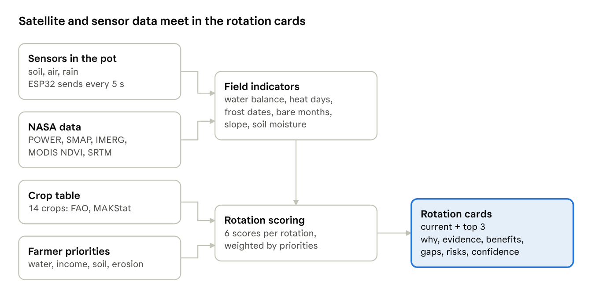

# Niva — Hackathon Game Plan

Nov 14, 2026 · Team Niva · NASA Space Apps Challenge 2026, Field Shift (Adapting Farms)

## Summary

Niva is a web app that compares at least three crop rotations for a field in Macedonia, using NASA satellite data plus live readings from our own ESP32 soil sensor. On stage we show a real plant in a pot with the sensors in its soil: we pour water, the app's soil-moisture number jumps live, and the rotation advice updates next to the NASA data.

The winning idea in one line: **satellites see the whole region, our sensor sees the one field, and Niva combines both into rotation advice a farmer can understand.**

What we build, in order of importance:

1. **Rotation comparison** (the heart of the challenge): the farmer's current rotation vs 3 alternatives, each with why, evidence, benefits, information gaps and risks.
2. **Field conditions from NASA**: rain, heat, frost, soil moisture, vegetation and slope for the chosen field.
3. **Live ground sensor**: the ESP32 plant demo, shown next to the matching satellite value.
4. **Farmer priorities**: sliders such as save water, earn more, improve soil, little equipment.
5. **Scenario slider**: what if rainfall drops 20% or temperature rises 2 °C.

## What the challenge really asks for

The challenge asks for a **decision-support tool for crop rotations**, not a soil sensor. The sensor is our extra; the rotation comparison is what gets scored. Every line below comes from the challenge text, and every one must be visible in our demo.

| The challenge asks for | How Niva answers it |
| --- | --- |
| Use NASA Earth observations | POWER, SMAP, IMERG, MODIS NDVI, SRTM, shown with their names and dates |
| Combine with local soil information | Our ESP32 sensor + global soil map (texture, organic matter) |
| Use crop characteristics | A table of 14 crops grown in Macedonia: water need, root depth, nitrogen fixing, family, season |
| Use farmer priorities | Sliders: save water, earn more, improve soil, prevent erosion |
| Compare at least 3 rotations, including the existing one | Current rotation + 3 suggested, side by side |
| For each: why, evidence, benefits, gaps, risks | Five fixed headings on every rotation card |
| Show bare-field periods and vulnerable seasons | A 12-month bar per rotation: crop, bare, risk months in colour |
| Explain terms (evapotranspiration, NDVI, anomaly, frost risk) | A small "?" next to each term with a one-line plain explanation |
| Satellite vs ground measurement | The live sensor next to SMAP: why they differ and why both help |
| Explain uncertainty, where experts are needed | A confidence level on each rotation + "check with an agronomist" notes |
| Easy for farmers with little tech experience | Big numbers, few words, Macedonian and English |
| Supports, never replaces, farmer judgment | A clear line on the result screen saying so |

**Optional extras that score well if time allows:** a map with overlays, a timeline, and the rainfall/temperature scenario slider. The scenario slider is cheap to build and impressive in a demo, so we include it.

**How judges score.** Space Apps judges usually score Impact, Creativity, Validity, Relevance and Presentation. Our answer to each: Impact = small farmers in Macedonia; Creativity = sensor + satellite together; Validity = real NASA data, honest about limits; Relevance = every row of the table above; Presentation = the live plant demo.

## The resources: what to use and what to skip

Use 6 datasets well, not 20 badly. Half of the list is US-only (USDA, USGS, PRISM and others) and has no data for Macedonia, so we skip those entirely. Judges reward a few datasets clearly explained over a long logo wall.

### Use these (core)

| Dataset | What Niva takes from it | How to get it fast | Effort |
| --- | --- | --- | --- |
| **NASA POWER** | Daily temperature min/max, rain, humidity, sun, wind for 30+ years: heat days, frost dates, water balance | Free web API, no login, one URL per field returns JSON. Use it live in the app | Easy, start here |
| **MODIS NDVI** (MOD13Q1, 250 m, every 16 days) | How green the fields are through the year: shows bare-field months and stress seasons | ORNL DAAC MODIS subset web service, no login, JSON for one point | Easy |
| **SMAP soil moisture** (9 km) | Satellite soil moisture: compare to our sensor, show dry-year anomalies | NASA Earthdata login (free) + AppEEARS point request; download once, save as a file | Medium, request early because it queues |
| **GPM IMERG** (rain, about 10 km) | Rain reliability, heavy-rain events that cause erosion | Earthdata login + Giovanni "area-averaged time series", export CSV | Medium |
| **SRTM elevation** (30 m) | Slope of the field: erosion risk, where water runs off | One tile download for Macedonia from Earthdata or AppEEARS | Easy once logged in |
| **FAO GAEZ** | Which crops are suitable in this climate and soil | Look up the suitability layers for our 14 crops and our 3 regions, type the scores into the crop table | Easy, manual |

### Nice to have (only if the core works)

| Dataset | What it adds | Why it is not core |
| --- | --- | --- |
| **Sentinel-2** (ESA, 10 m) | Field-sized greenness, sharper than MODIS | Needs a Copernicus account and image processing |
| **ECOSTRESS** | Plant water use and heat stress per field | Irregular passes, gaps over Macedonia, slow to process |
| **ERA5** (ECMWF) | Long climate record, soil temperature | Duplicates POWER; good backup if POWER is down |
| **GRACE / GRACE-FO** | Long-term groundwater trend for the Balkans | About 300 km pixels: one number for the whole country, good for one slide only |

One non-NASA extra worth adding: **ISRIC SoilGrids** (global soil map, free API, no login) for soil texture and organic matter, because the US soil surveys in the list do not cover Macedonia.

### Skip (no data for Macedonia, or wrong subject)

Web Soil Survey, SSURGO/STATSGO2, CropScape/CDL, PRISM, NAIP, NLCD, NLDAS, CoCoRaHS, NWIS, USDA AMS Market News, NASS QuickStats, OpenET, LANDFIRE are all **US-only**. USDA Ag Data Commons is mostly US research data. GEDI measures forests and tall vegetation, not crops. GLDAS (the global twin of NLDAS) is usable but adds nothing POWER and SMAP do not already give us.

**For prices and local crop facts** use the State Statistical Office of North Macedonia (MAKStat database: crop area, yields, producer prices). This replaces the US market and statistics sources.

### Three demo locations

Pre-load data for three real farming areas so the demo never waits on the internet: **Strumica valley** (vegetables, early season), **Ovče Pole** near Sveti Nikole (dry grain land, the water story) and **Pelagonija** near Bitola (wheat, frost risk). Save every NASA download as a JSON file in the app.

## The demo plant: ESP32 and sensors

One potted plant stands for one farmer's field: every sensor in or around the pot has a NASA dataset it is compared with. That pairing is the story judges should remember.

### What each sensor does

| Sensor | Where it goes | What it measures | Compared with (NASA) |
| --- | --- | --- | --- |
| Capacitive soil moisture v1.2 | Pushed into the soil, up to the line on the board | Soil water, shown as % | SMAP soil moisture |
| DS18B20 (waterproof probe) | In the soil, 5 cm deep | Soil temperature | POWER surface temperature |
| BME280 / BMP280 | Next to the plant, in the shade | Air temperature, humidity (BME only), pressure | POWER temperature and humidity |
| DHT22 | Next to the plant | Air temperature and humidity (backup for the BMP280, which has no humidity) | POWER humidity |

**Leave the Flying Fish gas sensor (MQ series, the one with the metal mesh head) out.** It measures gases like smoke or ammonia, which has nothing to do with crop rotation and no NASA data to compare against. It also needs 5 V, uses a lot of power for its heater, needs minutes to warm up, and its output can damage the ESP32's 3.3 V input without a voltage divider. Rain is covered by satellite data (IMERG) instead of a rain sensor.

### Wiring (all sensors on 3.3 V, not 5 V)

| Sensor pin | ESP32 pin | Note |
| --- | --- | --- |
| Soil moisture AOUT | GPIO 34 | Analog input only, fine for sensors |
| DS18B20 data (yellow) | GPIO 4 | 4.7 kΩ resistor between this wire and 3.3 V |
| BME/BMP280 SDA | GPIO 21 | Solder the pin header first |
| BME/BMP280 SCL | GPIO 22 | Address 0x76 or 0x77 |
| DHT22 data | GPIO 27 | Not GPIO 15 (startup pin) |
| All VCC / GND | 3V3 / GND | Use the breadboard rails |

Power: the USB cable from a laptop or a power bank is enough for everything. No battery needed.

### Calibration (15 minutes, do it on day 1)

- [ ] Soil sensor in dry air: write down the raw number (this is 0%)
- [ ] Soil sensor in a glass of water up to the line: write down the raw number (this is 100%)
- [ ] Put both numbers in the code, so the app shows % instead of raw numbers
- [ ] Check DS18B20 and BME280 against each other in the same air: they should agree within about 1 °C

### How the readings reach the app

The ESP32 sends one small JSON message every 5 seconds, for example `{"soil":43,"soilTemp":17.2,"airTemp":21.5,"humidity":48,"pressure":1012}`.

- **Main road: WiFi.** ESP32 and laptop both join **a phone hotspot** (venue WiFi often blocks devices talking to each other). The ESP32 sends each reading over HTTPS to our Niva server on Oracle Cloud, and every phone or PC with Niva open sees it.
- **Backup road: USB cable.** The ESP32 prints the same JSON over USB, and the web app reads it with the browser's Web Serial feature (Chrome/Edge). No network needed. Build this backup; it saves the demo if WiFi fails.

### The 20-second demo moment

1. The soil is dry; the app shows "Soil moisture 18% — dry, below what SMAP shows for the region".
2. We pour a glass of water.
3. Within 5 seconds the number climbs to about 45% and the card turns green: "Field watered — no irrigation needed this week".
4. We point at the rotation screen: the advice used this field's real data, not only the satellite average.

## How the app works

Niva turns raw data into **field indicators**, scores each rotation against them and the farmer's priorities, and explains every score in plain words. No black box: every number on a card can be traced to a dataset and a date range.

Sensor and satellite data become field indicators; crops and priorities join at scoring; the farmer sees only the cards.

### Step 1 — Field indicators (computed per location)

| Indicator | Computed from | Why a farmer cares |
| --- | --- | --- |
| Monthly water balance (rain minus crop water use) | POWER rain + evapotranspiration, IMERG rain | Which months a crop must be irrigated |
| Heat-stress days (above 35 °C, June–August) | POWER daily max temperature | Maize and peppers suffer, sorghum copes |
| Last spring frost, first autumn frost | POWER daily min temperature | Safe sowing and harvest window |
| Heavy-rain days (above 20 mm in a day) | IMERG / POWER rain | Erosion on bare soil |
| Slope | SRTM | Erosion and run-off |
| Bare-field months | MODIS NDVI (low greenness) | When soil is unprotected |
| Soil moisture anomaly | SMAP vs its own 2015–today average | Is this year drier than normal |
| Live field soil moisture and temperature | Our ESP32 | The real field, today |
| Trend: last 10 years vs 1991–2020 | POWER | Is the climate moving, and which way |

### Step 2 — Crop table

A small table of 14 crops common in Macedonia: winter wheat, barley, maize, sunflower, tobacco, alfalfa, pepper, tomato, bean, chickpea, rapeseed, sorghum, vetch–oat cover crop, mustard cover crop. For each: plant family, sowing and harvest months, water need (mm per season), root depth, nitrogen fixing yes/no, heat and frost tolerance, ground cover, market value. Sources: FAO crop water tables, FAO GAEZ suitability, MAKStat prices. **One team member fills this table on day 1; it is the most important data in the app.**

### Step 3 — Rotation scoring

We keep a library of about 10 sensible 3–4 year rotations (for example wheat → sunflower → chickpea → barley + cover crop). Each rotation gets six scores from 0 to 100:

| Score | Goes up when | Goes down when |
| --- | --- | --- |
| Water | Crops need less water than the field gets | Thirsty crops in dry months |
| Soil health | A nitrogen fixer, deep roots, a cover crop | Same crop every year |
| Erosion | Soil covered in heavy-rain months, on slopes | Bare months match heavy-rain months |
| Pest break | No plant family twice in a row | Same family back to back |
| Climate fit | Crops tolerate the local heat and frost | Heat days or frost hit a weak crop |
| Income | Higher market value, local demand | Low price, no buyer nearby |

The farmer's priority sliders set the weight of each score. The app shows the **current rotation plus the top 3**.

### Step 4 — The rotation card

Every rotation card has the same five headings the challenge asks for:

- **Why suggested** — the two scores that lifted it most, in one sentence
- **Evidence** — the actual numbers, with dataset and years ("23 heat days a year, POWER 2015–2024")
- **Benefits** — water saved (mm), months of bare soil removed, nitrogen added
- **Information gaps** — for example "no lab soil test", "SMAP pixel is 9 km, larger than the field"
- **Risks to review locally** — for example "chickpea market in this region not checked", "ask an agronomist"

Plus a **confidence level** (high / medium / low): high when the sensor and satellite agree and we have 20+ years of data, lower when they disagree. Under it, a 12-month strip shows crop months, bare months and risk months in colour.

### The AI model: soil-moisture forecast

Niva trains one small, explainable model on NASA data: it predicts a field's soil moisture 7 days ahead. The rotation scoring stays rule-based on purpose, because no data exists to train a rotation-picking model for Macedonia and the challenge asks for explanations.

| Part | What we do |
| --- | --- |
| Goal | Predict SMAP soil moisture 7 days ahead for each demo location |
| Inputs | Last 7 and 30 days of POWER rain, max/min temperature, humidity, sun, wind; last SMAP value; month of the year |
| Target | SMAP soil moisture 7 days later (9 km, daily, 2015–today: about 3,000 rows per location) |
| Model | Random forest, Python scikit-learn. Trains in minutes |
| Test | Train on 2015–2022, test on 2023–2024; report the average error on the slide |
| Explainable | Feature importance chart: which inputs mattered most (for example rain in the last 7 days) |
| Uncertainty | Spread of the trees' predictions = the confidence band shown in the app |
| Field correction | The live ESP32 reading shifts the forecast to this exact field (SMAP sees 9 km, the sensor one spot) |
| Used for | The rotation Water score, dry-spell warnings and the "irrigate this week?" advice |

Steps for the Data role (about 4 hours once SMAP arrives):

1. Join POWER daily and SMAP daily on date into one table per location
2. Build the input columns (7- and 30-day sums and averages)
3. Train the random forest, check the error on 2023–2024
4. Save the trained model file and copy it to the Oracle server, which makes a fresh forecast every day
5. Save the feature-importance chart and the error number for the slides

**Backup if SMAP is late:** train on ERA5 soil moisture (free through the Open-Meteo historical API, no login) with the same steps, and say so honestly.

On top, an optional language model writes each rotation card in plain Macedonian or English, using only the numbers on the card.

### Screens

1. **Choose your field** — tap the map or pick a region, enter the current rotation, set the priority sliders
2. **My field now** — live sensor numbers next to the NASA values for the same place
3. **Climate story** — four small charts: water balance by month, heat days per year, frost dates, greenness over the year
4. **Compare rotations** — current + 3 cards side by side, with the 12-month strips
5. **Rotation details** — the five headings, sources, confidence
6. **What-if** — rain −20% / temperature +2 °C sliders; scores update instantly

Every screen: Macedonian/English switch, a "?" beside each term, and the line "Niva supports your decision; it does not replace your experience or a local agronomist."

## Tech stack

Niva is one website that farmers can also install as an app: a **PWA (Progressive Web App)**. On a phone it sits on the home screen with the Niva icon and opens full screen like a native app; on a PC it runs in the browser or installs as a desktop app. One codebase, one link for the judges, nothing to download from an app store.

| Part | Tool | Why |
| --- | --- | --- |
| ESP32 code | Arduino IDE + libraries OneWire, DallasTemperature, Adafruit BME280 (or BMP280), DHT sensor library, ArduinoJson, WiFi, HTTPClient, WiFiClientSecure, WiFiManager | All standard, lots of examples |
| AI model | Python + pandas + scikit-learn (random forest): trained on our PC, then runs on the Oracle server | The server makes a fresh forecast every day with new POWER data and the live sensor |
| App server | Python + FastAPI on an Oracle Cloud free server, behind Caddy for HTTPS; SQLite database | Receives ESP32 readings, runs the AI model and rotation scoring, serves data to the app 24/7 |
| Web app | Vite + React, or plain HTML + JavaScript if faster for us | Simple, fast to build; vite-plugin-pwa makes it installable |
| Map | Leaflet + OpenStreetMap | Free, no key |
| Charts | Chart.js | Four charts in an hour |
| Data files | JSON files in the repo (one per demo location) | Demo works offline |
| Look | `niva-theme.css` from our brand pack (gray, yellow, white, green accent) | Already done |
| Hosting | GitHub Pages for the website (free HTTPS); Oracle Cloud Always Free server for the backend | Free; a link for the submission |

**The live sensor works everywhere, not only on stage.** The ESP32 sends readings to our Oracle server, so the hosted app shows them on any phone or PC. If the server fails, the app replays a recorded session saved as JSON, clearly labelled "recorded".

### Install on phone and PC (the PWA part)

| Device | How a farmer installs Niva |
| --- | --- |
| Android phone (Chrome) | Open the link, tap **Install Niva** in the app (or the browser's "Install app") |
| iPhone (Safari) | Open the link, tap Share → **Add to Home Screen**; the app shows these steps itself |
| PC or laptop (Chrome, Edge) | Use it as a website, or click the install icon in the address bar |

What makes it a PWA (about 1 hour of work for the App role):

- [ ] **Manifest file:** name "Niva", short name "Niva", icons at 192 and 512 px made from `square-latin-2.svg`, theme colour deep green `#145C38`, opens full screen (`display: standalone`)
- [ ] **Service worker:** stores the app and the demo-location data, so Niva opens with weak or no signal in the field and shows the last saved readings
- [ ] **HTTPS hosting:** GitHub Pages gives it for free; a PWA cannot install without it
- [ ] **Install button:** an "Install Niva" button on Android and PC, and short Add-to-Home-Screen steps on iPhone
- [ ] **Phone-first layout:** one column, big numbers, a bottom tab bar on phones; on a PC the rotation cards sit side by side

### The Oracle server (backend)

One Oracle Cloud Always Free server runs the whole backend 24/7, including the AI model, so the site keeps working during the weeks of global judging. GitHub Pages serves the website; the website calls the server.

| Piece | Choice |
| --- | --- |
| Server | Oracle Cloud Always Free, Ubuntu. Ampere A1 (ARM); if it says "out of capacity", the small AMD VM.Standard.E2.1.Micro |
| App | Python + FastAPI, run by uvicorn as a systemd service so it restarts after a reboot |
| HTTPS | Caddy in front of FastAPI, automatic certificate; free address from sslip.io (no sign-up): `https://niva-api.92-5-133-111.sslip.io` |
| Database | One SQLite file: devices, fields, readings |
| AI model | The trained random forest file (kept small, about 100 trees) loaded once when the server starts |
| Daily job | Every morning: fetch new NASA POWER data, re-run the forecast, update the rotation scores |

API endpoints (enough for the demo):

- `POST /readings` — the ESP32 sends a reading with its device ID and secret key
- `GET /fields/{id}/live` — the latest sensor reading
- `GET /fields/{id}/forecast` — 7-day soil-moisture forecast with its confidence band
- `GET /fields/{id}/rotations` — current rotation + top 3, with scores and explanations
- `POST /devices/pair` — links a sensor (its QR code) to a field

Setup checklist:

- [ ] Start the Oracle signup in hour 0–1: card verification can take a while
- [ ] Open ports 80 and 443 in the Oracle security list **and** in the server's own firewall (iptables)
- [ ] Start Caddy, check that `https://niva-api.92-5-133-111.sslip.io/docs` opens on a phone using mobile data
- [ ] Allow the GitHub Pages address in FastAPI's CORS settings
- [ ] ESP32 uses WiFiClientSecure with the Let's Encrypt root certificate

Why HTTPS everywhere: the PWA on GitHub Pages is HTTPS, and browsers block it from calling a plain `http://` server.

**Backup if Oracle is not working by hour 3:** run the same FastAPI code on a laptop behind a free Cloudflare Tunnel (it gives HTTPS too). The code is identical, so moving to Oracle later is a copy.

### Connecting a farmer's ESP32

Pairing works like a smart plug, so farmers never touch code:

1. Each sensor box has a sticker with a QR code and a short code such as `NIVA-4K7Q`
2. Plugged in with no known WiFi, the ESP32 opens its own network, **"Niva-Setup"** (WiFiManager library)
3. The farmer joins it on the phone, picks the farm WiFi and types its password
4. The ESP32 connects and sends readings to the server with its device ID and secret key
5. In the app: **Add sensor** → scan the QR code → pick the field. Done

For the hackathon we build this with our one device and print one QR sticker. At real farm scale, fields far from WiFi would use LoRa or a mobile SIM: we say so as the next step.

Folder plan for the repo: `esp32/` (sensor code), `server/` (app server), `web/` (the app), `data/` (NASA downloads per location, crop table), `docs/` (slides, screenshots).

## Timeline and team roles

Four roles work in parallel from hour 0, and everything must be working end-to-end by the end of day 1, ugly or not. Day 2 is for polish, the pitch and the submission. Hours count from the official start; confirm the local submission deadline with the Skopje organizers on arrival.

### Roles

| Role | Owns | First task |
| --- | --- | --- |
| Hardware | ESP32, sensors, calibration, the plant | Wire everything, print readings over USB |
| Data | NASA downloads, crop table, indicators | Earthdata login, request SMAP in AppEEARS (it queues) |
| App | Server, web app, rotation scoring | App skeleton with the Niva theme and 6 empty screens |
| Story | Pitch, slides, video, submission page, testing | Write the 3-minute pitch draft, collect photos |

With fewer people, merge Story into Data and Hardware into App after hour 6.

### Day 1

- [ ] **Hour 0–1** — Everyone: read this plan, create the GitHub repo, make Earthdata accounts, start the Oracle Cloud signup, agree on the JSON format for sensor data
- [ ] **Hour 1–4** — Hardware: all sensors read over USB. Data: POWER for 3 locations saved, SMAP and IMERG requested. App: skeleton + map, installable as a PWA; Oracle server running with HTTPS. Story: pitch draft
- [ ] **Hour 4–8** — Hardware: calibration + WiFi posting. Data: crop table (14 crops) + MODIS NDVI. App: "My field now" screen with live data
- [ ] **Hour 8–12** — Data: indicator calculations + train the soil-moisture forecast model. App: rotation scoring + comparison cards. Hardware: Web Serial backup, plant setup
- [ ] **Hour 12** — **Checkpoint: the whole path works once**: sensor → app → scores → cards. If not, cut features now (see Risks)

### Day 2

- [ ] **Hour 12–18** — Climate story charts, What-if sliders, Macedonian text, "?" explanations
- [ ] **Hour 18–20** — Feature freeze. Only bug fixes after this
- [ ] **Hour 20–22** — Record the demo video, take screenshots, deploy the hosted version
- [ ] **Hour 22–24** — Fill in the submission page, rehearse the pitch 3 times with a timer
- [ ] **Before the deadline** — Submit at least 1 hour early

Sleep in shifts: at least two people awake with the laptop running at any time.

## Pitch, demo and submission

The pitch is 3 minutes and the live plant is the middle of it. Open with a farmer's problem, show the plant, end on the rotation cards.

### 3-minute pitch

1. **0:00–0:30 — The problem.** "Farmers in Macedonia face hotter summers, less reliable rain and tired soil. Choosing what to plant next year is a guess."
2. **0:30–1:00 — The idea.** "Satellites see the whole region; our 10-euro sensor sees one field. Niva combines both." Show the logo and the plant.
3. **1:00–1:40 — Live demo.** Tap the Niva icon on a phone, pour water on the plant and the number jumps on the phone; then show "My field now" next to SMAP on the projector.
4. **1:40–2:30 — The rotations.** Current rotation vs 3 alternatives for Ovče Pole. Read one card: why, evidence, benefits, gaps, risks. Move the "rain −20%" slider.
5. **2:30–3:00 — Impact and honesty.** "Six NASA datasets, a 10-euro sensor, free for every farmer. It supports the farmer's judgment; it never replaces it."

### Questions judges will ask (prepare one-line answers)

- Why does the sensor disagree with SMAP? (SMAP averages 9 km and the top 5 cm; our sensor is one point)
- How do you know the rotation advice is right? (Rules from FAO crop data; the confidence level and "check locally" notes show the limits)
- Where is the AI? (A soil-moisture forecast trained on 10 years of SMAP + POWER, with its error and confidence shown; rotation scoring stays explainable on purpose)
- How would a farmer get the sensor? (About 10 euro in parts; one sensor per field or per village)
- What would you build next? (Sentinel-2 field maps, more crops, agronomist review, SMS alerts)

### Submission checklist

Check the exact fields on the Space Apps submission form; these are the usual ones.

- [ ] Project title and a short summary (use the team description as a base)
- [ ] Demo: a 30-second video or a short slide deck, as the form asks
- [ ] Link to the project: GitHub repo + hosted web app
- [ ] List of NASA data used, with links: POWER, SMAP, GPM IMERG, MODIS, SRTM (+ ECOSTRESS or GRACE if used)
- [ ] Partner and other data: FAO GAEZ, ISRIC SoilGrids, MAKStat, Sentinel-2/ERA5 if used
- [ ] Statement of AI tools used, if the form asks for one
- [ ] Team photo (the Niva PNG) and all members joined to the team page

## Risks and backup plans

The biggest risk is building too much, not too little. A working path from sensor to rotation card beats ten half-built screens.

| Risk | Backup plan |
| --- | --- |
| Behind schedule at hour 12 | Cut in this order: What-if sliders → Climate story charts → map (use a region dropdown) → IMERG (use POWER rain). Never cut the rotation cards or the live sensor |
| Venue WiFi blocks the ESP32 | Phone hotspot; if that fails, the USB Web Serial backup (laptop only: Web Serial does not work on phones) |
| SMAP or IMERG download is slow or fails | Request on hour 1. If nothing by hour 8, show POWER only and list SMAP as "next step" |
| A sensor breaks or reads nonsense | Keep the 3 spare resistors and a second soil probe; the app hides any sensor that sends nothing |
| NASA API down during the pitch | All demo data saved as JSON files in the app |
| Advice looks wrong to a judge who knows farming | Confidence levels, "information gaps" and "check with an agronomist" are visible on every card |
| Laptop dies on stage | Hosted version + recorded video on a second phone |

### Open questions for the team

- [ ] Exact local submission deadline and pitch time in Skopje
- [ ] Do we want any extra sensor beyond the four core ones? (Default: no)
- [ ] Which current rotation do we use for the demo farmer (for example wheat → wheat → sunflower in Ovče Pole)?
- [ ] Who on the team presents?
