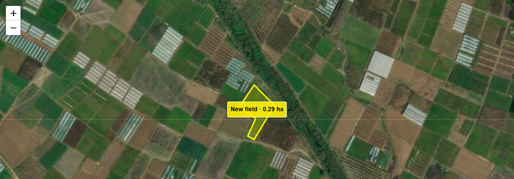
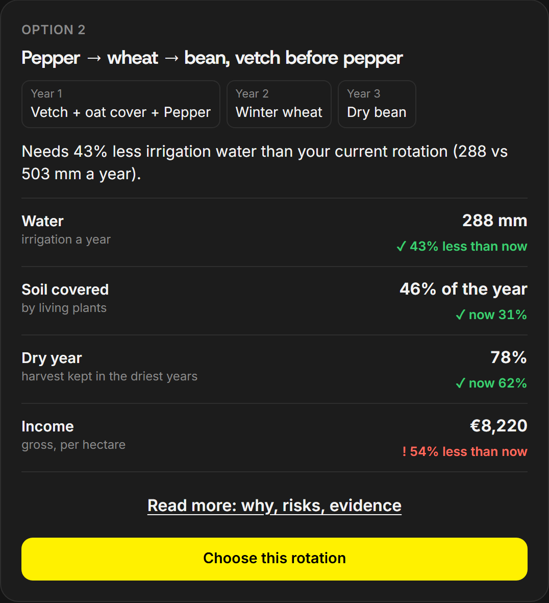
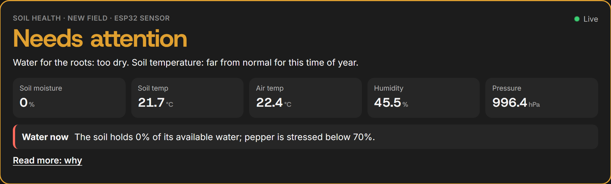
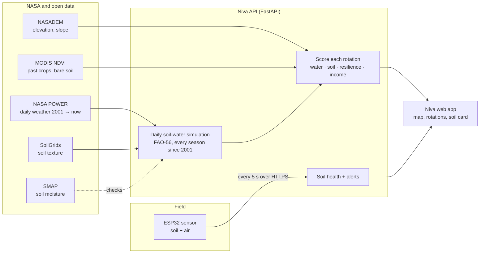

<p align="center">
  
</p>

<p align="center">
  <b>Crop-rotation advice for your field, from 25 years of NASA data and a soil sensor in the ground.</b><br>
  Built for North Macedonia · NASA Space Apps Challenge 2026
</p>

<p align="center">
  <a href="https://david-zaev.github.io/niva/"><b>Open the app</b></a> ·
  <a href="#how-it-works">How it works</a> ·
  <a href="#nasa-data-we-use">NASA data</a> ·
  <a href="#run-it-yourself">Run it yourself</a>
</p>

---

## What Niva does

A farmer draws a field on the map. Niva then answers three questions:

1. **What should I grow here in the next few years?** At least three crop rotations are compared with what the
   farmer grows now. Each one says how much irrigation water it needs, how long the soil stays covered, how much
   harvest it keeps in a dry year and what it earns, with the reasons, the evidence, the risks and what we don't know.
2. **How is my soil doing right now?** An ESP32 sensor in the field measures soil moisture, soil temperature, air
   temperature, humidity and pressure every few seconds, and the app turns that into a simple verdict
   (Healthy / Needs attention / Poor) and live alerts for frost, heat, storms and disease weather.
3. **Why?** Every number links back to the dataset it came from.

The app works in **English and Macedonian**, on a phone or a PC, and can be installed as an app.

<p align="center">
  
</p>

<table>
  <tr>
    <td width="50%"></td>
    <td width="50%"></td>
  </tr>
  <tr>
    <td align="center"><sub>One rotation option, compared with the current crops</sub></td>
    <td align="center"><sub>Soil health from the sensor in the field</sub></td>
  </tr>
</table>

## How it works



**The rotation engine.** For the field's location, Niva downloads NASA POWER daily weather since 2001 and computes
how much water crops need each day (FAO-56 Penman-Monteith). It then replays every candidate rotation through every
season of those 25 years with a daily soil-water balance, using the field's own soil (texture and water holding from
SoilGrids) and slope (NASADEM). From that it scores:

| Score | What it means |
|---|---|
| **Water** | Irrigation needed per year, compared with the current crops |
| **Soil** | Share of the year the soil is covered by living plants, erosion on sloped fields |
| **Resilience** | Harvest kept in the driest years, frost and heat risk at planting |
| **Income** | Gross income per hectare from local prices and yields; a big drop is flagged |

Plant rules from Macedonian agronomy (no two crops of the same family in a row, crops that must not follow each
other, cover crops before the right main crops) remove rotations that would be bad practice, before scoring.

**The sensor never changes the rotation plans.** The rotations come from data about the place; the sensor tells
the farmer how the soil is doing today.

## NASA data we use

| Dataset | Resolution | What Niva uses it for |
|---|---|---|
| [NASA POWER](https://power.larc.nasa.gov/) daily | ~50 km | Temperature, humidity, wind, sun, rain, soil wetness and soil temperature, 2001 to now. Crop water demand (ET0) and the 25-year simulation |
| [NASADEM](https://www.earthdata.nasa.gov/esds/competitions/nasadem) | 30 m | Elevation and slope over the field outline (erosion) |
| [MODIS MOD13Q1 NDVI](https://lpdaac.usgs.gov/products/mod13q1v061/) | 250 m | Bare-soil periods, past crop pattern, stressed summers |
| [SMAP L3 Enhanced](https://nsidc.org/data/spl3smp_e) | 9 km | Checks that the simulated soil water rises and falls with the satellite's |

Also used: [ISRIC SoilGrids](https://soilgrids.org/) 250 m for soil texture, organic matter and pH, and
OpenStreetMap for the country border.

We checked the engine against references: our ET0 matches the FAO-56 worked example (3.88 vs 3.9 mm/day), and our
simulated root-zone water follows NASA's own GWETROOT over the demo farm (r = 0.62).

## What we don't know yet

We show these limits in the app as "information gaps":

- NASA POWER is about 50 km wide and a small field is one or two MODIS pixels.
- SoilGrids is a model of the soil, not a sample. A lab test confirms texture, organic matter and pH.
- One probe measures one spot. The sensor covers the water side of soil health, not nutrients or soil life.
- Crop parameters are FAO-56 table values, not calibrated for Macedonian varieties.
- Prices and yields are rough and must be checked with local buyers.

## The field sensor

An ESP32 with five sensors posts one reading every 5 seconds in the demo (every 10 minutes in a real field).

| Value | Sensor | Pin |
|---|---|---|
| Soil moisture | Capacitive probe v1.2 | 34 |
| Soil temperature | DS18B20 waterproof probe | 14 |
| Air temperature, humidity | DHT22 | 4 |
| Air pressure | BMP280 / BME280 | 21 (SDA), 22 (SCL) |

A sensor that is missing or fails sends `null`, never a wrong number. All pins and timings are in
[`firmware/niva_sensor/config.h`](firmware/niva_sensor/config.h).

## Run it yourself

You need Python 3.12+, Node 20+ and, for the sensor, the Arduino IDE.

### Backend (API)

```bash
python -m venv .venv
.venv/Scripts/pip install -r backend/requirements.txt     # macOS/Linux: .venv/bin/pip
cd backend
../.venv/Scripts/python seed.py                          # once: the demo farm in Murtino, Strumica valley
../.venv/Scripts/uvicorn main:app --reload
```

The API runs at `http://localhost:8000` (interactive docs at `/docs`) and keeps its data in `niva.db`. NASA POWER data is downloaded the first time a place is asked for and cached
in `data/cache/`. Slope and SMAP need `data/scripts/download_dem.py` and `download_smap.py` (optional: without them
those checks are shown as information gaps).

### Web app

```bash
cd web
npm install
npm run dev
```

Open `http://localhost:5173/niva/`. To use the live API instead of a local one, put
`VITE_API_BASE=https://niva-api.92-5-133-111.sslip.io` in `web/.env.development.local`.

### Sensor (ESP32)

1. Copy `firmware/niva_sensor/secrets.example.h` to `secrets.h` and put in the device key.
2. Open `niva_sensor.ino` in the Arduino IDE: board **ESP32 Dev Module**, partition scheme **Huge APP**.
3. Upload. With no saved Wi-Fi the board opens a `Niva-Setup` network: join it on a phone and pick your Wi-Fi
   (2.4 GHz only).

Add the device on the server, inside `backend/`:

```bash
python manage.py add-device NIVA-A1F3      # prints the device key once: put it in secrets.h
python manage.py pair NIVA-A1F3 1          # device -> field 1
python manage.py devices                   # check when each device was last heard from
```

### Deploy

[`deploy/setup.sh`](deploy/setup.sh) sets up a fresh Ubuntu server: Python, the `niva-api` systemd service and Caddy
for HTTPS. The web app is published to GitHub Pages by [`.github/workflows/pages.yml`](.github/workflows/pages.yml)
on every push to `main`.

## Project structure

```
backend/                 FastAPI server
  main.py                  API routes
  power.py                 NASA POWER download + cache, FAO-56 ET0
  simulate.py              daily soil-water simulation of a rotation
  rotations.py             scoring, rotation cards, "why / evidence / risks"
  plants.py                plant rules (families, what may follow what)
  soil.py terrain.py       SoilGrids soil, NASADEM slope
  ndvi.py smap.py          MODIS NDVI, SMAP check
  climate.py               climate profile of the place
  health.py sensor.py      soil health card and live alerts from the ESP32
  region.py                North Macedonia border check
  mk.py                    Macedonian translation of the advice
  manage.py                devices and fields from the command line
data/
  rotation/                crops (FAO-56 parameters), rotation library, plant rules
  geo/                     North Macedonia border
  scripts/                 NASADEM and SMAP download scripts
web/                     React + Vite + Leaflet app (English and Macedonian)
firmware/niva_sensor/    ESP32 sketch
deploy/                  server setup (systemd, Caddy)
brand/                   logo and theme
docs/reference/          agronomy and market notes behind the rotation library
```

## Next steps

GPM IMERG daily rain, Sentinel-2 10 m NDVI, ECOSTRESS evapotranspiration, GRACE groundwater trends and several
sensors per farm.

## Team

Made for the [NASA Space Apps Challenge 2026](https://www.spaceappschallenge.org/) in North Macedonia.

<!-- Team members: add names here -->

NASA does not endorse this project. Parts of the code and text were written with the help of an AI assistant.
